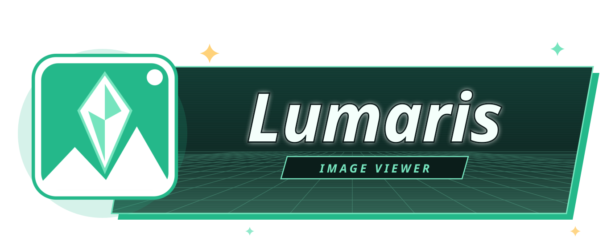
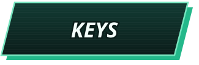
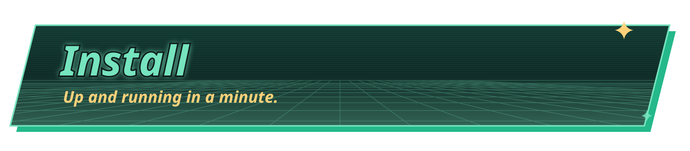
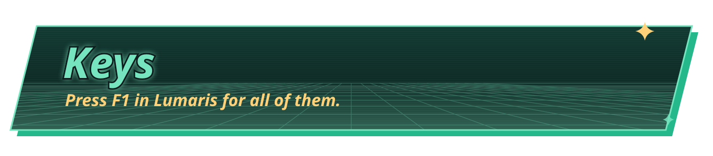
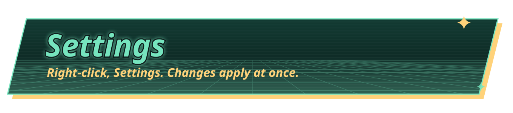
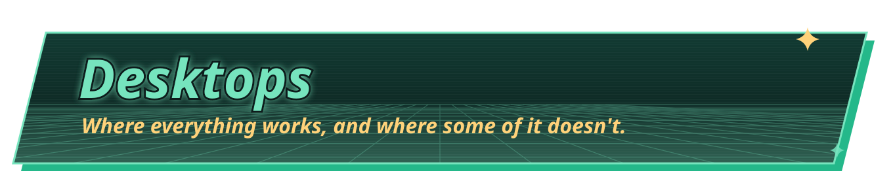
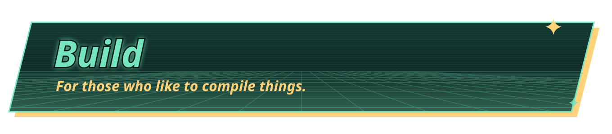

<div align="center">



**A lean and fast image viewer for Linux**

<sub>Written in Rust • Drawn on the GPU • Made for KDE Plasma on Wayland</sub>

<a href="#install"></a>
<a href="#features"></a>
<a href="#keys"></a>
<a href="#settings"></a>
<a href="#desktops"></a>
<a href="#build"></a>
<a href="CHANGELOG.md"></a>

</div>

<p align="center"></p>

Lumaris opens in about a tenth of a second and stays out of the way: no toolbar, no editing, just
your image, with the blurred desktop behind it.

> [!NOTE]
> **Made and tested on KDE Plasma 6 (Wayland).** It runs on other Wayland desktops and on X11 too,
> with a few niceties missing; see [Desktops](#desktops).

### <a name="install"></a>

**Arch Linux:** a PKGBUILD (`lumaris-git`) is in `packaging/aur/`:

```sh
cd packaging/aur && makepkg -si
```

**Anywhere else:** build it from source (needs Rust 1.85 or newer and the libraries listed under
[Build](#build)):

```sh
./install.sh                 # builds and installs to ~/.local (program, desktop entry, icon)
lumaris <image or folder>
```

`sudo PREFIX=/usr/local ./install.sh` installs system wide. To open your images with Lumaris,
choose it in **System Settings → Default Applications**.

### <a name="features"></a>

- **Smooth, sharp zoom:** zooms around the mouse pointer, with bicubic enlargement, smooth
  reduction, square pixels for pixel art and SVGs that stay sharp at any size.
- **A window that fits:** opens centred and sized to the image, then grows and shrinks with your
  zoom (Shift+wheel zooms just the image).
- **Part of the desktop:** see-through window with the blurred desktop behind it, and a right-click
  menu in your KDE colours and font that can reach beyond the window.
- **Browsing:** next and previous in natural order (`img2` before `img10`), sort orders, looping,
  slideshows with fades, and comic archives (.cbz) that open like a folder.
- **Desktop tools:** open with your apps (default first), open the folder, copy the image or its
  path, move to the trash, drag and drop, and your own commands on keys.
- **Details on demand:** image info with camera details and a histogram, a navigation panel with a
  zoom map, rotate and flip.
- **Private by design:** no history, no thumbnails, no recent files. The only thing it writes is
  your settings.

<details>
<summary><b>Formats</b></summary>

JPEG, PNG, GIF, WebP, AVIF, HEIF/HEIC, JPEG XL, SVG, camera RAW, EXR and Radiance HDR (tone
mapped), PSD/PSB, GIMP XCF, Krita, OpenRaster, JPEG 2000, PDF (first page), TIFF, BMP, QOI, ICO,
TGA, PNM, DDS and farbfeld. Animated GIF, WebP and PNG play, and embedded colour profiles are
applied.

</details>

### <a name="keys"></a>

Every key can be changed in the settings.

| Key | Action |
|---|---|
| Right / Left | Next / previous image |
| Mouse wheel, + / - | Zoom (Shift+wheel: the window keeps its size) |
| Space / Enter | Fit or 100% / fit to window |
| 1 to 9 | Slideshow, 1 to 9 seconds per image |
| R, H, V | Rotate, flip horizontally, flip vertically |
| Ctrl+C / Ctrl+Shift+C | Copy the image / its file path |
| I, N, F1, Ctrl+, | Image info, navigation panel, keys, settings |
| F11, double click | Full screen |
| Esc | Close a panel, stop the slideshow, leave full screen, quit |

<details>
<summary><b>All keys</b></summary>

| Key | Action |
|---|---|
| Page Down / Page Up, Backspace | Next / previous image |
| Home / End | First / last image |
| 0 | Original size (100%) |
| Up, Down, Ctrl+Left, Ctrl+Right | Move the image when zoomed in |
| Shift+R | Rotate left |
| F | Full screen |
| Ctrl+O | Open image |
| Ctrl+E | Open the containing folder |
| Delete | Move to trash |
| Ctrl+Q | Quit |
| Mouse back / forward | Previous / next image |

</details>

### <a name="settings"></a>

Open them with right-click → **Settings** or Ctrl+,. Everything is also in plain text files in `~/.config/lumaris/`, if you prefer an editor:

| File | What's in it |
|---|---|
| `lumaris.conf` | All settings, each with a short explanation |
| `keys.conf` | Key bindings |
| `commands.conf` | Your own commands: `Name \| Key \| Command`, where `%f` is the image and `%d` its folder |

### <a name="desktops"></a>

| | KDE Plasma (Wayland) | Other Wayland desktops | X11 |
|---|---|---|---|
| Blurred background | ✓ | Where the compositor offers it | See-through or solid |
| Centred window that follows the zoom | ✓ | Placed by the compositor | Placed by the window manager |
| Menus beyond the window | ✓ | With the layer shell (wlroots based) | Inside the window |

Not tested yet: other desktops, X11, fractional scaling (125%, 150%) and several monitors.
[Reports are welcome](https://github.com/0xRJDev/Lumaris/issues).

### <a name="build"></a>

| | Packages (Arch names) |
|---|---|
| Required | `libheif` `libraw` `dav1d` `lcms2` `fontconfig` `wayland` `libxkbcommon`, a Vulkan or OpenGL driver |
| Recommended | `wl-clipboard` (copying), `xdg-desktop-portal` (open dialog) |
| Optional | `poppler` (PDF), `xclip` (copying on X11), `kdialog` or `zenity` (open dialog without a portal) |

```sh
cargo build --release
cargo test
```

<details>
<summary><b>Testing and debugging</b></summary>

`LUMARIS_DEBUG_TIMING=1` prints startup timings. `LUMARIS_AUTOTEST=<file>` runs a test script,
one command per line: `wheel <steps> <x> <y>`, `key <name>`, `rclick` / `lclick` / `move <x> <y>`,
`settings`, `info`, `wait <ms>`, `quit`. It is used to test Lumaris in a hidden, nested KWin, and
`examples/fakeclick` sends real pointer clicks there.

</details>

<div align="center">

<br>

**[Report a bug or share an idea](https://github.com/0xRJDev/Lumaris/issues)**

<sub>Lumaris is free software under the [GNU GPL, version 2 or later](LICENSE).</sub>

</div>
