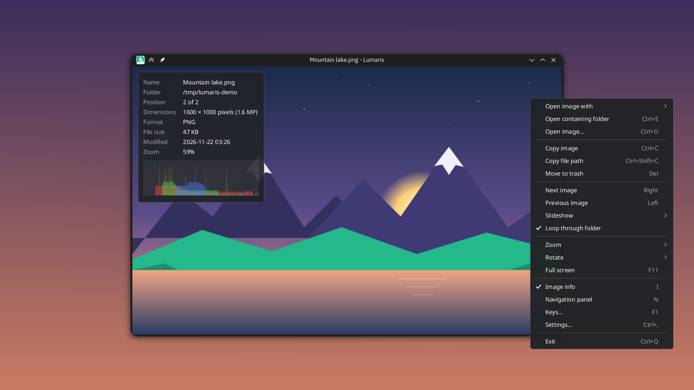

<p align="center"></p>

# Lumaris

A lean and fast image viewer for Linux, written in Rust. It opens in about a tenth of a second,
draws on the GPU and stays out of the way: no toolbar, no editing, just the image.

Made for KDE Plasma on Wayland, where it looks and behaves like part of the desktop; it also runs
on other Wayland desktops and X11 with fewer niceties (see [Desktops](#desktops)).



## Features

**Viewing**
- GPU drawing (Vulkan, OpenGL fallback): bicubic when enlarging, smooth mipmaps when reducing,
  sharp square pixels for pixel art, exact pixels at 100%
- Smooth zoom around the mouse pointer; the window grows and shrinks with the image (Shift+wheel
  zooms only the image), the zoom is shown for a moment
- The window opens centred and fitted to the image; small images open enlarged
- Transparent window with the blurred desktop behind it, or a solid colour or checkerboard
- Rotate and flip the view, full screen, navigation panel with a zoom map, image info with EXIF
  camera details and a histogram

**Browsing**
- Next / previous image of the folder in natural order (`img2` before `img10`), looping; the
  neighbours are decoded in advance
- Sort by name, date, size or randomly; slideshow (keys 1 to 9 = seconds per image) with fades
- Comic archives (.cbz / .zip) open like a folder of their pages
- Open dialog, drag and drop, single window mode

**Files and desktop**
- Right-click menu in the desktop's style (KDE font and colours), also beyond the window
- Open with the applications associated with the file type (your default first), open the
  containing folder, copy the image or its path, move to the trash
- Your own commands in the menu and on keys

**Formats**
JPEG, PNG, GIF, WebP, AVIF, HEIF/HEIC, JPEG XL, SVG (sharp at any zoom), camera RAW, EXR and
Radiance HDR (tone mapped), PSD/PSB, GIMP XCF, Krita, OpenRaster, JPEG 2000, PDF (first page),
TIFF, BMP, QOI, ICO, TGA, PNM, DDS, farbfeld. Animated GIF, WebP and PNG play. Embedded colour
profiles are applied.

**Privacy**
Lumaris keeps no history, thumbnails or recent files. The only file it writes is your settings.

## Install

### Arch Linux

A PKGBUILD is in `packaging/aur/` (`lumaris-git`):

```sh
cd packaging/aur && makepkg -si
```

### From source

Needs Rust 1.85 or newer and these libraries (Arch package names):

| | Packages |
|---|---|
| Required | `libheif` `libraw` `dav1d` `lcms2` `fontconfig` `wayland` `libxkbcommon`, a Vulkan or OpenGL driver |
| Recommended | `wl-clipboard` (copying on Wayland), `xdg-desktop-portal` (open dialog) |
| Optional | `poppler` (PDF), `xclip` (copying on X11), `kdialog` or `zenity` (open dialog without a portal) |

```sh
./install.sh                 # builds and installs to ~/.local (program, desktop entry, icon)
lumaris <image or folder>
```

`sudo PREFIX=/usr/local ./install.sh` installs system wide. To make Lumaris the default image
viewer, choose it in System Settings > Default Applications.

## Keys

Press F1 in Lumaris for the full list. All keys can be changed (Settings > Edit key bindings).

| Key | Action |
|---|---|
| Right, Page Down / Left, Page Up, Backspace | Next / previous image |
| Mouse wheel, + / - | Zoom around the pointer (Shift+wheel: the window keeps its size) |
| Space / Enter / 0 | Fit or 100% / fit / 100% |
| Up, Down, Ctrl+Left, Ctrl+Right | Move the image when zoomed in |
| R / Shift+R, H / V | Rotate right / left, flip horizontally / vertically |
| 1 to 9 | Slideshow, 1 to 9 seconds per image |
| Ctrl+C / Ctrl+Shift+C | Copy the image / its file path |
| Ctrl+O, Delete | Open image, move to trash |
| I, N, F1, Ctrl+, | Image info, navigation panel, keys, settings |
| F11, F, double click | Full screen |
| Esc | Close a panel, stop the slideshow, leave full screen, quit |

## Settings

Right-click > Settings (or Ctrl+,) changes everything that can be set; changes apply at once.
The files, all in `~/.config/lumaris/`, can also be edited by hand:

| File | Contents |
|---|---|
| `lumaris.conf` | Settings, with an explanation of each one |
| `keys.conf` | Key bindings |
| `commands.conf` | Your own commands: `Name \| Key \| Command`, `%f` = the image, `%d` = its folder |

## Desktops

| | KDE Plasma (Wayland) | Other Wayland desktops | X11 |
|---|---|---|---|
| Blurred background | Yes | Where the compositor offers it | No (see-through or solid) |
| Window opens centred, follows the zoom centred | Yes | The compositor places the window | The window manager places it |
| Menus beyond the window | Yes | With the layer shell (wlroots based) | Inside the window |

Tested on KDE Plasma 6 (Wayland) with NVIDIA. Not tested yet: other desktops, X11, fractional
display scaling (125%, 150%), several monitors. Reports are welcome.

## Building and testing

```sh
cargo build --release
cargo test
```

`LUMARIS_DEBUG_TIMING=1` prints startup timings. `LUMARIS_AUTOTEST=<file>` runs a test script
(one command per line: `wheel <steps> <x> <y>`, `key <name>`, `rclick` / `lclick` / `move <x> <y>`,
`settings`, `info`, `wait <ms>`, `quit`), used to test Lumaris in a nested, hidden KWin.

## License

GNU General Public License, version 2 or later (see `LICENSE`).
